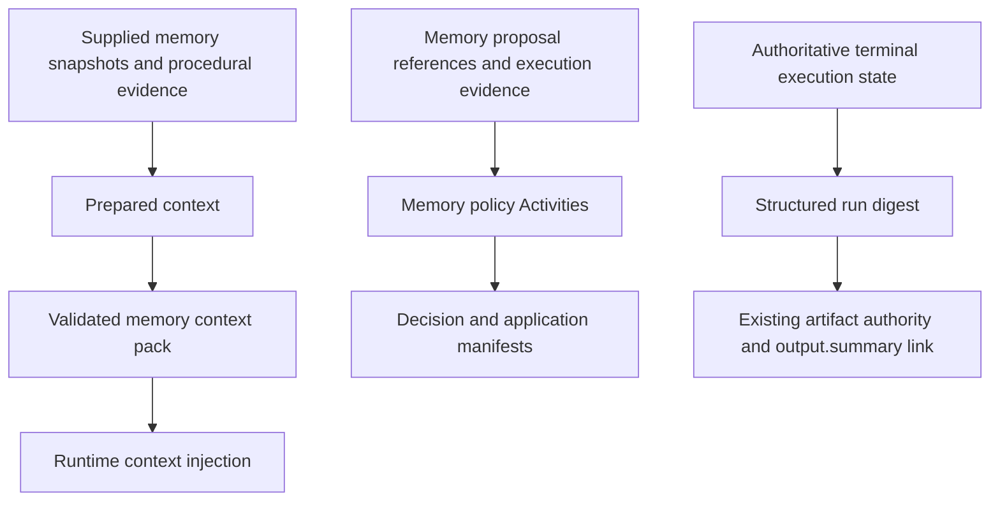

# MoonMind Memory Architecture

MoonMind prepares bounded memory context, evaluates memory proposals, and records
structured run digests through the existing workflow and artifact owners. These
paths use explicit evidence references and procedural signatures without a
managed vector index.

## Implementation owners

| Surface | Owner | Result |
| --- | --- | --- |
| Prepared runtime context | `moonmind/workflows/executions/prepared_context.py` | A context bundle assembled from supplied snapshots and scoped procedural evidence. |
| Memory context packaging | `moonmind/memory/context_pack.py` | Validated, token-budgeted items with provenance, stable item references and a content digest. |
| Procedural memory | `moonmind/memory/procedural.py` | Evidence-backed error signatures, fix patterns and memory proposals; `FileFixPatternStore` owns file-backed pattern persistence. |
| Proposal and application policy | `moonmind/memory/services.py` | Compact policy-decision and application-result manifests used by the memory Activity handlers. |
| Structured run digest | `moonmind/memory/run_digest.py` | The run-digest model, pure construction helpers and artifact envelope. |
| Durable digest publication | `TemporalArtifactActivities` in `moonmind/workflows/temporal/artifacts.py` | A bounded `run_digest.json` artifact linked as `output.summary` through `TemporalArtifactService`. |

## Preparing context

The prepared-context owner accepts explicit memory snapshots and procedural
inputs. `build_memory_context_pack` normalizes each candidate's text, source,
plane, trust class, provenance and token cost. Candidates must carry a usable
evidence pointer; secret-like values are rejected during validation.

Items are considered in supplied order. An item that exceeds the remaining token
budget is recorded in `skippedRefs`. The pack includes accepted items, budget and
usage metadata, a builder version and a digest that excludes the creation time.
These identities support replaying the same prepared evidence without
reinterpreting it as a fresh lookup.

The `planning`, `history`, `long_term` and `document` plane labels describe
supplied context. They do not select retrieval providers. Callers own source
selection, namespace/repository admission and authorization of referenced
artifacts before supplying candidates. The context builder requires provenance
and applies the packaging budget.

## Procedural evidence

`ErrorSignature` and `FixPattern` in `procedural.py` describe evidence-backed
procedural memory. `FileFixPatternStore` persists patterns in its configured
file-backed store. Prepared-context assembly scopes procedural evidence to the
requested namespace and repository and can turn matching patterns into memory
proposals.

Source references and provenance remain attached to the resulting context.
Model/provider selection belongs to execution configuration; reusable memory
provenance stays focused on durable execution and evidence identities.

## Memory policy

The registered memory Activity handlers in `activity_runtime.py` call
`evaluate_memory_proposals` and `apply_memory_policy` from `services.py`.

Proposal evaluation validates the execution source identity and records a
decision for each proposal reference. Repository application requires an accepted
terminal disposition and a passed publication gate. Run-context decisions and
repository decisions retain their separate target requirements.

Application policy checks the decision reference and applicable gates, then
returns a compact result manifest with its outcome, result reference and failure
reason. Persistence and mutation remain responsibilities of the calling
workflow's existing owners. These helpers create no planning/history store or
retrieval service.

## Run digests and retained artifacts

The structured `RunDigest` model lives in `run_digest.py`. It preserves the
workflow/run identity, namespace, repository, outcome and evidence references
used by terminal finalization. It is separate from procedural context packaging.

Terminal finalization records authoritative execution state before its
best-effort digest write. The existing artifact service owns durable content,
metadata, authorization and links. Digest publication retains its run-scoped
idempotency and resumes an existing pending artifact when needed. A completed
artifact is reused on retry; unrelated ownership is not adopted as a successful
write.

Digest failures and timeouts follow the existing best-effort finalization path.
They do not authorize repeating completed agent or publication work. Retained
artifact identities, contents, source references and access checks continue to
belong to the artifact authority.

## Configuration

`WorkflowSettings.memory_context_budget_tokens` controls prepared memory context:

- `MOONMIND_MEMORY_CONTEXT_BUDGET_TOKENS` is the primary environment name.
- `MEMORY_CONTEXT_BUDGET_TOKENS` remains a compatibility alias.
- The primary name takes precedence when both are supplied.
- The default is 4096 tokens, and the value must be positive.

`MEMORY_LONG_TERM` accepts only `off`. Selecting a retired long-term provider
fails configuration validation. This setting does not enable a hosted Mem0
client or a long-term-memory lookup.

Optional-context handling stays with the prepared-context caller, and summary
write failures stay with the terminal artifact owner.
