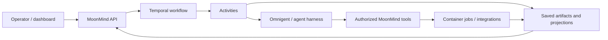

# MoonMind Architecture

MoonMind is a self-hosted, single-operator application for running agentic work.
Temporal coordinates durable workflows; Omnigent runs the agents. MoonMind owns
access, context, workspaces, saved results, and the browser controls around them.

## One workflow through the system



1. The operator submits a task, repository, selected harness and Provider
   Profile, and any publication choices. The API validates the request and
   starts a durable workflow.
2. `MoonMind.UserWorkflow` coordinates its steps, waits, retries, and
   cancellation. Workflow code is deterministic: it schedules work rather than
   directly calling providers, databases, Docker, or the filesystem.
3. Activities resolve context, credentials, and workspaces and start the
   appropriate execution. Ordinary agent work runs through `MoonMind.AgentRun`
   on Omnigent; tool-only work can use an Activity or container job.
4. The agent uses authorized tools to work on the task. Builds and tests that
   need containers go through MoonMind's container-job API. The agent does not
   receive the deployment's Docker socket.
5. Outputs, diagnostics, and recoverable work are saved as artifacts. The API
   and dashboard project workflow state and saved evidence into progress,
   controls, logs, and results. Publishing a result is a separate authorized
   operation; successful computation does not imply successful publication.

For the exact registered workflow types and worker routes, use the
[generated reference](Temporal/WorkflowTypeCatalogGenerated.md). It is generated
from production registries rather than maintained as another list here.

## Find the relevant explanation

| Question | Start here |
| --- | --- |
| How does a workflow execute, retry, or recover? | [Execution model](Temporal/ManagedAndExternalAgentExecutionModel.md), [steps and checkpoints](Steps/StepExecutionsAndCheckpointing.md) |
| How does MoonMind run an agent? | [Omnigent entry point](Omnigent/README.md) |
| Where do workflow state and dashboard status come from? | [State and projections](Temporal/SourceOfTruthAndProjectionModel.md) |
| How do credentials and provider selection work? | [Provider Profiles](Security/ProviderProfiles.md), [Secrets](Security/SecretsSystem.md) |
| How are builds and tests isolated? | [Docker Backend Service](ManagedAgents/DockerBackendService.md) |
| How are Skills resolved and delivered? | [Skill System](Steps/SkillSystem.md) |
| How are results saved and published? | [Artifacts](Temporal/WorkflowArtifactSystemDesign.md), [publishing](Workflows/WorkflowPublishing.md) |
| How do I diagnose a running or failed workflow? | [Workflow Console](UI/WorkflowConsoleArchitecture.md), [Live Logs](Observability/LiveLogs.md) |
| What runs locally, and how is it updated? | [Service inventory](FirstRunServiceInventory.md), [Compose updates](Steps/DockerComposeUpdateSystem.md) |

## Ownership and durable state

| Component | Responsibility | Important boundary |
| --- | --- | --- |
| API and dashboard | Accept requests, enforce access, expose controls and results | They do not run a competing workflow state machine. |
| Temporal workflows | Durable orchestration, timers, retries, cancellation, and child workflow relationships | Side effects run in Activities or external services. |
| Workers and Activities | Execute side effects and integrations | An Activity retry must account for effects that may already have happened. |
| Omnigent | Agent hosts, harnesses, sessions, and provider-native execution | MoonMind retains workflow, credential, workspace, and publication authority. |
| PostgreSQL | Application settings, records, and durable projections | A projection does not replace Temporal's execution history. |
| Artifact storage | Large outputs, logs, checkpoints, and result evidence | Workflow history carries compact references rather than large bodies or secrets. |
| Docker backend | Bounded workload containers and shared image cache | Deployment-owned infrastructure is not agent-owned workspace state. |

Temporal's service persists history and dispatches tasks. Workers poll queues
and execute workflow or Activity handlers; the Temporal service does not execute
MoonMind application code. Task queues route work internally and do not promise
product-level FIFO ordering. See [worker topology](Temporal/ActivityCatalogAndWorkerTopology.md).

## Recovery and results

A workflow, a logical step, and an execution attempt are different identities.
A retry can replace an interrupted attempt without repeating completed steps.
Recovery uses verified checkpoints or admitted inputs, with unavailable recovery
reported explicitly. The detailed support and compatibility conditions live in
[execution and checkpointing](Steps/StepExecutionsAndCheckpointing.md).

A live session or container is a continuity cache, not the only recoverable copy
of work. Saved artifacts and durable metadata remain inspectable when the host
or interactive connection is unavailable. Terminal outcomes come from execution
evidence, not assistant prose, process presence, or a wrapper exit alone.

Compute, saving, publication, and cleanup have separate outcomes. A publication
failure must not hide saved work; cleanup must not remove its only recoverable
copy. When an external operation's answer is lost, recovery first establishes
what happened before repeating an effect. These distinctions explain why a
single success/failure flag cannot describe the whole journey.

<a id="single-user-application-model"></a>

## Access and execution boundaries

One operator controls an instance, with concurrent workflows and multiple
provider or repository connections. Single-user operation does not grant agents
unrestricted operator access. The [single-user design](SingleUserApplicationDesign.md)
explains the target model and migration constraints; existing account-era access
must remain protected until its replacement is implemented.

Provider Profiles select execution credentials and defaults. Secrets remain
references until the controlled launch boundary and stay out of workflow
history. Repository access, model-provider credentials, artifact access, and
publication authority are separate concerns.

Containerized tools follow this path:

```text
agent -> authenticated MoonMind tool -> Docker Backend Service
      -> Temporal container job -> trusted worker -> configured Docker backend
```

The API validates logical workspace references, resources, permitted images,
and caller authority. Trusted workers operate Docker through the configured
backend; agents do not receive a Docker socket, deployment credentials, or
arbitrary host-path mounting authority. A socket proxy alone is not an
agent sandbox. Network confinement also requires its own enforced boundary;
see [Restricted Egress](Security/RestrictedEgress.md).

The deployment's image store is shared cache state. Workflow cleanup removes
owned transient resources without pruning that cache or another workflow's
resources. Workspace visibility is checked before expensive image acquisition,
and private-image access is checked even if the image is already cached.

## Context and observability

MoonMind assembles bounded context from task intent, referenced documents,
attachments, prior evidence, and resolved Skills. It is vector-free: ordinary
execution has no MoonMind-managed vector database, embedding service, or
semantic-retrieval index. Exact artifact/history reads are a different capability
from semantic recall. See [context and memory](Memory/MemoryArchitecture.md).

Resolved Skills are execution inputs with durable references; their large bodies
are materialized near the runtime. Native session context can improve continuity,
but cannot be the sole basis for recovery.

Logs, traces, and artifacts carry correlation identifiers for workflows, runs,
steps, sessions, and jobs as applicable. The dashboard's live transport is a
convenience: recorded diagnostics remain readable if live chat or streaming
fails. Sensitive content is excluded or redacted at its owning boundaries.

## Compatibility paths

Omnigent is the primary agent backend for Codex, Claude Code, and OpenCode.
The [Omnigent support documentation](Omnigent/RuntimeProviderRollout.md) describes
which combinations the deployment currently admits; installation is not proof
that a journey has been qualified.

Direct `codex_cli` and `claude_code` managed runtimes remain compatibility
Backends under Advanced. Direct Codex also supplies the workflow-scoped
`MoonMind.AgentSession` implementation. These paths have their own retained
consumers and replay requirements; their existence does not establish a new
parallel architecture to extend. See [managed agents](ManagedAgents/ManagedAgentArchitecture.md).

Optional external systems such as OpenClaw use adapters that normalize status,
results, and supported cancellation into MoonMind's execution contracts. They
run outside MoonMind's managed runtime envelope. See [external integrations](ExternalAgents/ExternalAgentIntegrationSystem.md).

## Local deployment

Docker Compose runs the API/dashboard, Temporal, persistence, workers, artifact
services, and configured agent infrastructure. The existing system Docker daemon
can also serve container jobs through the trusted backend. There is no separate
MoonMind daemon requirement.

The [service inventory](FirstRunServiceInventory.md) lists services and ports.
The [deployment updater](Steps/DockerComposeUpdateSystem.md) owns upgrades,
retained settings, interrupted-update recovery, and independent host-side repair.
