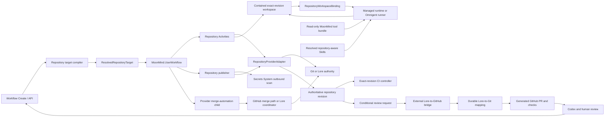

# Lore VCS Integration — System / Feature Design View

**Status:** Proposed  
**Document Class:** Canonical declarative  
**Viewpoint:** System / Feature Design View  
**Audience:** MoonMind contributors, workflow and runtime authors, integration authors, security reviewers, operators, and repository administrators  
**Scope:** Provider-discriminated repository targets, repository connections, Lore-backed workspaces, repository capabilities, publication evidence, generated-review handoff, exact-revision CI, and provider-authoritative merge automation  
**Related Docs:** [`WorkflowArchitecture.md`](./WorkflowArchitecture.md) (repository authoring and compilation), [`WorkflowPublishing.md`](./WorkflowPublishing.md) (publication evidence, outcomes, merge automation), [`RequiredCapabilities.md`](./RequiredCapabilities.md) (capability semantics and readiness), [`WorkspaceLocators.md`](./WorkspaceLocators.md) (sandbox authority, binding, restore), [`ManagedAgentsGit.md`](../ManagedAgents/ManagedAgentsGit.md) (GitHub credential resolution), [`OmnigentHostMountedTools.md`](../Omnigent/OmnigentHostMountedTools.md) (tool bundles), [`SecretsSystem.md`](../Security/SecretsSystem.md) (`SecretRef`, outbound scanning), [`SkillSystem.md`](../Steps/SkillSystem.md) (Skill metadata), [`MoonMindArchitecture.md`](../MoonMindArchitecture.md), [`SkillAndPlanContracts.md`](./SkillAndPlanContracts.md)  
**Related Implementation:** [`repository_contract.py`](../../moonmind/workflows/executions/repository_contract.py), [`execution_contract.py`](../../moonmind/workflows/executions/execution_contract.py), [`moonmind/repositories/`](../../moonmind/repositories/), [`moonmind/publish/`](../../moonmind/publish/), [`moonmind/auth/`](../../moonmind/auth/), [`moonmind/workflows/temporal/runtime/`](../../moonmind/workflows/temporal/runtime/), [`api_service/services/repository_connections.py`](../../api_service/services/repository_connections.py)

This document describes the intended design. The provider-discriminated repository contract, repository connections with the default Git connection, and the Lore workspace adapter and checkpoints exist in the modules above; the rest describes the behavior those modules are built toward.

---

## 1. Purpose

For a GitHub-authoritative repository, repository selection, Git transport, GitHub authentication, pull-request publication, and merge automation can be coupled. That coupling does not fit a project whose authoritative revisions live in Lore and whose GitHub repository is a generated review projection.

This design makes repository authority explicit: one provider-discriminated repository target, a deployment-seeded default Git connection for the ordinary GitHub path, exact complete Lore workspaces delivered to every runtime lane, the real pinned Lore CLI plus provider-aware guidance for agents, exact identities carried through checkpoints, CI, publication, review, and merge, and merge automation compiled to the provider's authority boundary.

The motivating deployment is Tactics: a Lore repository containing root `Content/**`, exact-revision Unreal CI, and one-way generated Git history that omits root `Content/**` but keeps plugin-owned Content. MoonMind fits that model rather than creating a competing Lore-to-GitHub bridge or a GitHub-to-Lore sync path.

---

## 2. Desired behavior

### 2.1 Authority model

```text
Workflow author or review-remediation request
        |
        v
MoonMind resolves a Lore repository target
        |
        v
Exact Lore workspace, including paths omitted from GitHub
        |
        +---- agent reads and changes the workspace
        +---- MoonMind or a Lore-aware auto-publish Skill publishes
        v
Authoritative Lore work branch and exact Lore revision
        |
        +---- exact-revision CI
        +---- conditional, versioned review request
        v
External Lore-to-GitHub bridge
        |
        v
Generated Git commit, branch, pull request, and checks
        |
        +---- Codex and human review
        +---- findings become a new Lore-backed run
        v
Lore-side merge coordinator merges the approved Lore revision
```

Invariants:

1. **Lore is the content authority.** The repository id and immutable revision signature identify state; branch identity is carried separately.
2. **GitHub is a review projection.** A Git SHA, generated branch, or PR counts as current only once it maps to the exact Lore revision.
3. **GitHub never writes contents back into Lore.** Review findings feed a new Lore-backed run whose fix is projected again.
4. **The workspace is the complete Lore revision.** The filtered GitHub tree lacks root Content, Lore workspace state, and locks, so it is never substituted.
5. **A new Lore revision stales earlier CI and review evidence,** even when the generated Git tree is unchanged.
6. **Ordinary publication cannot merge protected Lore branches;** it may request review or submit to the external coordinator.
7. **Handoffs are conditional** on the exact expected branch state, so a later run cannot overwrite a newer revision's handoff.
8. **Merge automation is provider-authoritative.** Lore targets use the Lore coordinator and never compile to the GitHub-merging `pr-resolver` path.

### 2.2 Primary scenarios

- **Analyze an exact revision:** a revision selector with `publish.mode = "none"` prepares the complete revision and launches without mutation authority.
- **Publish a branch:** the agent changes the workspace and the deterministic publisher scans, stages, publishes with compare-and-set, and verifies (§3.12).
- **Request a generated PR:** after verified Lore publication, MoonMind writes a conditional review request and waits for the bridge's exact mapping; it never pushes the generated branch or creates the GitHub PR (§3.14–3.15).
- **Remediate review findings:** the generated PR is resolved through bridge mapping to the Lore branch, and fixes are published only to Lore.
- **Run exact-revision CI:** the controller materializes the Lore revision; a GitHub Check Run may mirror the result, but the Git SHA is never the input (§3.16).
- **Merge automation:** Git targets keep Git-provider automation; Lore targets submit to the coordinator, or are rejected before launch when none is configured (§3.17).

### 2.3 Compatibility with the Tactics projection contract

Root `/Content/**` is in the Lore workspace and CI input but not the generated GitHub tree; `Plugins/**/Content/**` is ordinary content. Content-only revisions remain publishable, CI-addressable, and reviewable even when the generated tree is identical, and review summaries distinguish code from root Content paths. Generated history, parent mapping, symlink reconstruction, fast-forward-only generated refs, and divergence quarantine belong to the bridge. The current Lore revision, not the GitHub head, gates CI, review freshness, and merge submission.

---

## 3. Shape

### 3.1 Component topology



Workflow code carries compact identities and orchestrates retries, waits, signals, and children. Credential resolution, filesystem and network work, repository client calls, scans, artifact writes, projection reads, and merge submission run in Activities or external services, keeping history deterministic and secret-free.

### 3.2 One repository contract

The provider-discriminated contract replaces, rather than aliases, earlier shapes: the top-level `repository` string with `task.git.branch` and nested `task.repository` become one top-level `repository` object; `task.auth.repoAuthRef`/`publishAuthRef` become `repository.connectionRef`; hardwired `git`/`gh` derivation becomes provider- and Skill-aware capability compilation; `acceptedRepositoryEvidence` and `moonmind.publish.auto.v1` become `moonmind.publish.repository.v1`; Git-named checkpoint and Omnigent fields become provider-discriminated identity; and GitHub-only merge automation becomes provider-authoritative.

New submissions use only the top-level contract. Recorded histories that predate it replay through a frozen, versioned reader that accepts no new submissions, because Temporal replay must still decode them. Evidence and connections cannot be adopted separately, since every publication result requires a `connectionRef` and client evidence. New schemas use the `moonmind.<contract>.vN` convention.

### 3.3 Repository connections and the default Git path

A `RepositoryConnection` (`moonmind.repository-connection.v1`), distinct from an LLM Provider Profile, carries a provider (`git` or `lore`), endpoint and trust-bundle refs, repository and operation allowlists (`read`, `write`, `branch_write`, `lock`, `review_request`, `merge_request`), a pinned client policy (version, compatible server versions, tool-bundle ref, executable SHA-256), and a credential source. Git uses `github_resolver` or `secret_ref`; Lore uses `secret_ref` or `trusted_network_development`, plus an optional review-only GitHub `projection` and optional `mergeCoordinator`.

- `credentialRef` appears exactly for `secret_ref` and is the Secrets System's typed `SecretRef`. The record holds no token, key, cookie, header, or absolute runtime path.
- `trusted_network_development` is eligible only under explicit development policy; reachability never makes it production-ready.
- Allowlists are checked before workspace preparation and again before mutation.
- The client policy is the expected value and the tool-bundle manifest is observed evidence; `latest` is never a durable identity, and a mismatch fails closed (`LORE_CLIENT_UNAVAILABLE`) without updating the connection.

#### Seeded default Git connection

The ordinary GitHub path uses `repository-connection:git-default`. A recorded default is authoritative; deployments upgraded from per-workflow GitHub credentials have it recorded with a typed `secret_ref` naming the GitHub source they actually used, so operators never create it by hand. While none is recorded, the default derives from the deployment's GitHub declaration (`github_resolver`): a configured GitHub token or SecretRef, then an active `GITHUB_TOKEN` or `GITHUB_PAT` managed secret, so a token saved in Settings still applies. Startup does not persist an always-on alias. A recorded connection whose credential fails stays failed rather than falling back to another token. A non-default connection authorizes a launch only for a repository with a verified assignment, and only for its operations.

The Create compiler injects the default when no advanced connection was chosen, so normalized payloads always carry an explicit ref and readiness invokes the canonical resolver. `ManagedAgentsGit.md` owns GitHub credential precedence, probes, and transport; the connection selects that resolver rather than duplicating it.

### 3.4 Authored repository target

The workflow carries one top-level `repository`: `provider`, `connectionRef`, `repository.name`, `branch.name`, and an optional `revision` (`git_commit`/`commitSha` or `lore_revision`/`revisionSignature`).

```json
{
  "repository": {
    "provider": "lore",
    "connectionRef": "repository-connection:tactics-lore",
    "repository": { "name": "Tactics" },
    "branch": { "name": "main" },
    "revision": { "kind": "lore_revision", "revisionSignature": "<immutable-signature>" }
  },
  "workflow": { "publish": { "mode": "none" }, "instructions": "Analyze this exact historical revision" }
}
```

A GitHub UI draft may omit `connectionRef`; the compiler inserts the default before validation and persistence. `revision` is valid for `none` and exact-revision Tool or CI requests, and is rejected for `branch`, `pr`, or `auto` because mutating from a historical checkout is ambiguous. For `pr` the authored branch is the base and MoonMind creates or resolves a work branch; for `branch` it is the branch to update; remediation may resolve the existing work branch from projection mapping.

### 3.5 Resolved repository identity

`ResolvedRepositoryTarget` (`moonmind.repository-target.v1`) records provider, connection, repository (`id`, `name`), base branch, optional work branch and its origin, prepared revision and branch, remote-tip expectation, client evidence (bundle ref, version, executable digest, server version), and any review-only projection.

Repository, branch, and revision are distinct axes. Git branch ids are full refs (`refs/heads/main`); Lore branch ids are stable provider ids. A Lore revision ref holds repository id and signature but no branch id, because the signature identifies immutable state while reachability and mutation target are branch concerns. The tip expectation is `must_equal` an observed tip, `must_not_exist` for a new work branch, or `read_only`. Revision numbers, display names, and generated Git SHAs never replace the provider revision.

### 3.6 Repository provider adapter

One provider boundary avoids scattering `if lore` branches. It covers target resolution and readiness; workspace preparation, binding, inspection, and work-branch resolution; locks; staging, commit, compare-and-set push, and remote verification; conditional review requests and projection reads; and checkpoints. The Lore workspace boundary is [`lore_adapter.py`](../../moonmind/repositories/lore_adapter.py).

The adapter calls the pinned CLI through bounded subprocesses with machine-readable output validated against MoonMind-owned schemas, never parsing human prose as durable state; a native binding may later replace this without changing contracts. It exposes no protected-branch merge.

### 3.7 Workspace authority, runtime delivery, cache isolation, and checkpoints

A prepared Lore workspace is materialized from the exact revision with every path, uses a `sandbox` authority locator, records its identity and connection in immutable metadata, starts with no unrelated dirty, staged, or locked state, is containment-checked before binding, and is the source for repository-scoped Skills.

`RepositoryWorkspaceBinding` delivers that one workspace to a lane: the managed launcher uses the sandbox as its repository root without a second checkout, and Omnigent bind-mounts it at the host workspace path, normally `/workspaces/run`. Checkpoint, restore, publication, and containment always target the authority locator. A lane that cannot bind it blocks before launch.

Lore state is split deliberately. Run-private mutable state (auth, indexes, staging, lock ownership, config, journals) is never shared. A deployment-shared object cache may hold immutable content-addressed objects when the client supports safe separation; it is read-only to runs, holds no credentials or locks, is populated atomically only by a trusted initializer, and digest-verifies every object on use, so one run cannot poison another's content and the cache can be rebuilt.

When an agent, Unreal Editor, compiler, or asset tool changes files outside Lore, the client's external-change scan runs before status, staging, checkpointing, publication, or a no-change conclusion; a clean result without a successful scan is not evidence.

`RepositoryCheckpoint` (`moonmind.repository-checkpoint.v1`, see [`lore_checkpoints.py`](../../moonmind/repositories/lore_checkpoints.py)) is either `repository_revision` (clean; restored from the immutable revision) or `repository_delta` (dirty; restored by materializing the base revision fresh, applying the bounded delta, running containment, symlink, and external-change checks, and re-staging only recorded staged paths). Mutable `.lore` state, auth, journals, and locks are never archived (`lockState` is always `not_captured`); the adapter rebuilds provider state and reacquires locks explicitly when still needed. Delta capture is size-bounded and fails with `LORE_CHECKPOINT_TOO_LARGE` rather than archiving unbounded Content.

### 3.8 Required capabilities and readiness

Repository support uses the existing `requiredCapabilities: string[]` contract.

| Capability | Meaning |
| --- | --- |
| `lore` | A compatible pinned Lore client, connection, trust policy, and workspace implementation are ready. |
| `repo.read` | The provider may resolve and prepare the requested state. |
| `repo.write` | The trusted publication owner may conditionally publish a revision. |
| `repo.branch.write` | The workflow may create, select, or advance a non-protected work branch. |
| `repo.lock` | Explicit locks are authorized and terminal reconciliation can clean them up. |
| `repo.review.request` | The workflow may write a conditional review request and read projection status. |
| `repo.merge.request` | The workflow may submit to the merge coordinator; no direct merge authority. |
| `git` | The Git client and workspace path are required; not an alias for repository presence. |
| `gh` | GitHub repository, PR, review, check, or merge-automation access is required. |

Derivation is additive: a Lore workspace adds `lore` + `repo.read` and a Git workspace `git` + `repo.read`; `branch` adds `repo.write` + `repo.branch.write`; `pr` adds those plus `repo.review.request` (Lore) or `gh` (Git); lock-using Skills add `repo.lock`; Lore merge automation adds `repo.merge.request`. Reading GitHub review state adds `gh`; waiting on the trusted bridge API does not.

Readiness is registry-driven. Unknown tokens fail closed with `REPOSITORY_CAPABILITY_UNKNOWN` rather than being ignored, and readiness completes before mutation, Tool execution, or launch. Lore merge automation without a compatible coordinator blocks with `LORE_MERGE_AUTOMATION_UNAVAILABLE`.

### 3.9 Agent-visible Lore tooling and runtime lanes

Agents get the real `lore` CLI at `/opt/moonmind-tools/bin/lore` in the read-only tool bundle. Its manifest records version, platform, archive digest, executable digest, and version probe; readiness checks them against the connection's client policy, and mounted-tool preflight is capability-table-driven rather than hardcoded to `gh`. Static Omnigent hosts are grouped by immutable bundle version rather than changed in place, and a run with no compatible host fails before session creation with `LORE_CLIENT_UNAVAILABLE`.

The runtime gets a run-private Lore config root and read-only trust material, never a global Lore home or another run's auth. For managed `branch` and `pr`, the agent gets local inspect-and-modify operations but no reusable remote-write credential; after it exits, the trusted publisher receives short-lived mutation material, validates, scans, publishes, and verifies. A Lore-aware `auto` Skill gets remote mutation only on an isolated runtime, only when its resolved content declares Lore support, and only when the same scan and evidence rules are enforced.

### 3.10 Lore VCS Agent Skill and provider support metadata

A portable `lore-vcs` Agent Skill ships with the executable as guidance, tested against the pinned client. Repository-mutating Skills declare `supported-providers`, publish owner, evidence schema, and required capabilities; `ResolvedSkillEntry` preserves `supported_repository_providers` and `publish_evidence_schema`. A writing Skill with no declared providers fails closed, Git-only Skills declare `[git]` and fail before running on Lore, and a later-precedence Skill with the same name does not inherit a built-in Skill's provider privileges.

`lore-vcs` teaches agents to read identity from workspace metadata, scan after non-Lore edits, distinguish dirty through merged states, use trusted ids, avoid protected branches, force, history rewriting, and generated refs, take locks only under `repo.lock` and never break another identity's lock, leave managed publication to MoonMind, and treat a GitHub PR URL as a review locator rather than a write target.

### 3.11 Bounded executable Tools and lock lifecycle

The CLI suits open-ended work inside a run; cross-system actions use typed Tools or trusted Activities.

| Tool | Purpose | Authority boundary |
| --- | --- | --- |
| `repository.inspect` | Repository, revision, status, changed-path, and lock evidence. | Read-only adapter. |
| `repository.request_review` | Conditional review request for the exact branch tip. | Adapter plus handoff policy. |
| `repository.projection_status` | Exact Lore-to-Git mapping, PR, and checks. | Read-only bridge API. |
| `repository.lock.acquire` / `.release` | Acquire scoped locks; release the run's own lease. | Adapter, lock policy, ownership check. |
| `repository.lock.reconcile` | Release or report orphaned run-owned locks. | Trusted Activity. |
| `repository.submit_merge_request` / `.merge_status` | Submit evidence to, and read status from, the coordinator. | Coordinator API; never a direct merge. |

A `RepositoryLockLease` records owning workflow, run, and step, paths, acquired revision, and `release_on_terminal` cleanup. Lock operations are idempotent, and success, failure, cancellation, timeout, runtime loss, and retry all enter trusted reconciliation. A path locked by another identity blocks with `LORE_LOCK_CONFLICT`; MoonMind does not break it as recovery. Failed cleanup is an operator-visible blocker.

### 3.12 Publish modes and deterministic publication

| Mode | Lore-backed behavior |
| --- | --- |
| `none` | Run in the workspace; no revision. Emits no publication evidence and finishes as `PUBLISH_DISABLED`. |
| `branch` | Publish and verify the exact work-branch revision; no GitHub PR. |
| `pr` | Publish, conditionally request projection, and wait for an exact generated PR mapping. |
| `auto` | A Lore-aware Skill owns side effects and emits the same evidence contract. |

Managed publication runs the external-change scan; captures status, locks, and paths; rejects contamination, protected targets, foreign locks, or branch movement; stages intended changes; builds the outbound bundle from revision metadata and the full diff; runs the Secrets System outbound scan before any push (findings name only category and location); publishes with compare-and-set or an exclusive lease; requires an exact remote match; and emits immutable evidence. The scan is enforcement, not Skill guidance.

Unconditional force, lease widening, and force-based conflict repair are not used. Git may use `--force-with-lease=<branch>:<exact-recorded-sha>`; Lore needs a provider compare-and-set, conditional update, or exclusive lease. A plain push with post-hoc verification leaves a time-of-check/time-of-use race, so without an atomic Lore primitive `repo.write` readiness fails. No-change is valid only when the revision is verified as the exact remote tip.

### 3.13 Unified repository publication evidence

`moonmind.publish.repository.v1` is the single evidence contract for managed (`owner: moonmind`) and agent-owned (`owner: agent`) publication, with identical required fields for both. It records mode, provider, status (`verified`, `no_op_verified`, `blocked`, `failed`), action, connection, repository, branch, base and published revisions, remote verification, client evidence, scan result, changed-path refs with `rootContentChanged`/`contentOnly`, and optional review-request and projection blocks.

Success requires the published revision to equal the observed remote revision; review actions require a successful conditional handoff for that revision. Pending projections omit unmapped Git fields rather than writing `null`. A Content-only Lore revision is not `NO_COMMIT` just because the generated diff is empty. Evidence carries safe connection and client refs, never credentials, and is never emitted without a resolved `connectionRef`.

| Evidence and external state | Workflow outcome |
| --- | --- |
| `branch`, `verified` | `PUBLISHED_BRANCH` |
| `pr`, Lore verified, projection pending | `awaiting_external` with `LORE_PROJECTION_PENDING` |
| `pr`, exact mapped commit and PR head | `PUBLISHED_PR` |
| `no_op_verified` | `NO_COMMIT` |
| `blocked` / `failed` or invalid | publish-stage blocked result / failure |

### 3.14 Conditional review-request handoff

A `moonmind.lore-review-request.v1` carries a stable request id, workflow ids, repository, work branch, published revision, expected branch tip (the same revision), base branch, bounded title and summary, and `rootContentChanged` — no credentials, prompts, private artifacts, or host paths. It is accepted only while the tip still equals the expected revision; a stale run gets `LORE_REVIEW_REQUEST_STALE`. Same id plus same revision is idempotent; a branch advance needs a new request. The preferred representation is an append-only bridge record keyed by repository, branch, revision, and request id. The bridge owns its queue, mapping database, generated refs, and GitHub App; MoonMind reads bridge status rather than inferring projection from metadata presence.

### 3.15 Projection status, workflow state, and bounded waiting

A `moonmind.lore-projection.v1` response has status `pending`, `mapped`, `diverged`, or `failed`, plus the Git commit and PR when mapped. A mapping is current only when its revision equals the current tip, the PR head equals the mapped commit, the active projection policy was used, and the branch is not quarantined.

| Bridge response | Workflow behavior |
| --- | --- |
| `pending`, or `mapped` without matching PR | remain `awaiting_external` and reconcile |
| `mapped` with exact PR head | `PUBLISHED_PR`, or start merge automation |
| `diverged` / `failed` | `LORE_PROJECTION_DIVERGED` / `LORE_PROJECTION_FAILED` |
| blank or unknown | `LORE_PROJECTION_STATUS_INVALID` |

Projection phase is a substate of `awaiting_external`, not a new top-level state. Waiting is bounded: before a soft deadline MoonMind reconciles with backoff; after it the UI offers reconcile/intervention while still reporting the verified publication; at the hard deadline the workflow fails with `LORE_PROJECTION_TIMEOUT`, preserving evidence so resume retries only projection reconciliation. Lagging rows never overwrite an authoritative mapping.

On Lore-backed runs, `gh` may read generated PRs, reviews, and checks, and MoonMind may post separately authorized comments, but nothing pushes the generated branch or uses GitHub's merge endpoint.

### 3.16 Exact-revision CI request and terminal evidence

A `moonmind.repository-ci-request.v1` names connection, repository, branch, exact revision, and idempotency key. The immutable `moonmind.repository-ci-result.v1` adds requested, observed, and branch-tip revisions, status (`succeeded`, `failed`, `cancelled`), controller version, artifacts, and any projected GitHub check. Success satisfies a gate only when all three revisions match; `cancelled` never does. A later tip makes results stale (`LORE_CI_STALE`) without mutating them; unknown statuses fail with `LORE_CI_RESULT_INVALID`. The controller preserves root Content and treats Content-only revisions as new inputs. Unreal build planning, asset validation, and packaging belong to Tactics CI design.

### 3.17 Provider-authoritative merge automation

`pr_with_merge_automation` stays one product concept, compiled by provider:

| Provider | Compiled behavior |
| --- | --- |
| Git/GitHub | `pr` plus Git-provider `MoonMind.MergeAutomation` and GitHub-authoritative merge |
| Lore with coordinator | `pr` plus a Lore merge-coordination child that submits a merge request and waits |
| Lore without coordinator | rejected before launch with `LORE_MERGE_AUTOMATION_UNAVAILABLE` |

`pr-resolver` participates on Lore only in a read/remediation role whose terminal operation is coordinator submission. The parent publishes, waits for mapping and current CI/review, remains `awaiting_external` while the child runs, and satisfies dependents only after authoritative merge success.

A `moonmind.repository-merge-request.v1` carries source and target branches with exact revisions, CI-result and projection refs, approval policy and evidence refs, and an idempotency key. Approval evidence may be GitHub approvals tied to the exact projected head, a MoonMind approval-gate artifact tied to the Lore revision, or coordinator-native evaluation; MoonMind never infers approval from comment prose.

| Coordinator response | Workflow behavior |
| --- | --- |
| `pending`, `accepted`, `merging` | `awaiting_external` with `LORE_MERGE_COORDINATOR_PENDING` |
| `merged` with exact source, target, and merge revisions | merge-automation success |
| `rejected` (tips moved) | `LORE_MERGE_REJECTED_STALE` |
| `rejected` (CI, review, approval, conflict, policy) | coordinator code, default `LORE_MERGE_REJECTED` |
| `failed` / blank or unknown | `LORE_MERGE_COORDINATOR_FAILED` / `LORE_MERGE_STATUS_INVALID` |

Waiting follows the projection deadline pattern, ending in `LORE_MERGE_COORDINATOR_TIMEOUT`; resume reuses the request id. The coordinator owns per-target serialization, tip and evidence freshness, conflict checks including Content, protected-branch policy, merge revisions, merge-parent projection, and generated-branch cleanup. A GitHub merge without a coordinator-confirmed Lore merge is an authority violation.

### 3.18 Security and credential materialization

Credentials follow the Secrets System's reference-over-value rule. Read-only runs get no write credential; managed `branch`/`pr` runs normally get no remote-write credential; `auto` runs get narrow mutation material only when Skill, scan, and isolation permit; coordinator credentials never reach an agent shell; GitHub and Lore credentials do not imply each other's permissions. Raw tokens are not passed as CLI arguments because they would leak into process listings, logs, and histories; until a safe pinned-client path is verified, authenticated agent-side mutation is unavailable. Readiness covers reachability, TLS, auth, authorization, client compatibility, digest, and a bounded probe, and MoonMind does not silently try another endpoint, identity, provider, or less-constrained runtime.

### 3.19 Concurrency, idempotency, and recovery

Every mutation uses an idempotency key from workflow, run, step, owner, provider, and operation, and the publisher records each prepared, local, pushed, and observed revision. A retry finding the revision already verified, the request already accepted, or the merge request already present reconciles the prior result rather than creating another. Unexpected movement blocks with `LORE_BRANCH_MOVED` and is never repaired by force. Success is not inferred from local state when remote verification is unavailable, nor failure from a lost notification; notifications are advisory wake-ups and consumers reconcile exact ids and revisions.

### 3.20 Diagnostics, artifacts, and UI

Stable codes include `REPOSITORY_PROVIDER_UNSUPPORTED`, `REPOSITORY_REVISION_SELECTOR_INVALID`, `REPOSITORY_DEFAULT_CONNECTION_UNAVAILABLE`, `LORE_CONNECTION_NOT_READY`, `LORE_REVISION_NOT_FOUND`, `LORE_WORKSPACE_BINDING_UNSUPPORTED`, `LORE_WORKSPACE_SCAN_FAILED`, `LORE_CACHE_INTEGRITY_FAILED`, `LORE_LOCK_CLEANUP_FAILED`, `LORE_OUTBOUND_SCAN_BLOCKED`, `LORE_PUSH_NOT_VERIFIED`, `LORE_REVIEW_REQUEST_FAILED`, and `LORE_MERGE_COORDINATOR_REQUIRED` (direct protected merge attempted), alongside the codes named above. Immutable `repository_*.json` artifacts cover target, readiness, binding, status, changed paths, checkpoint, locks, scan, publish result, review request, projection, CI, and merge, plus redacted diagnostics.

The UI shows the authoritative provider and exact identities, the connection and whether the default was used, remote verification, root Content changes, generated commit and PR as projection fields, freshness against the current Lore revision, the `awaiting_external` reason and deadlines, and failures needing operator action — never presenting generated Git state as Lore state.

---

## 4. Non-goals

- MoonMind is not the Lore-to-Git projection worker and does not force-reconcile generated refs.
- No webhook, PR action, merge button, push, or agent writes GitHub content back into Lore.
- MoonMind does not replace the Lore merge coordinator or bypass CI and review.
- MoonMind does not operate the Lore server (auth, CA, backup, upgrades, exposure).
- A filtered Git clone is not a workspace substitute, even for apparently code-only work.
- No custom Omnigent host solely for Lore; standard tool and Skill projection suffices.
- No structured state from human CLI prose.
- Tool presence grants no repository, write, lock, review, CI, or merge permission.

---

## 5. Runtime lane support

A lane supports a capability only when its workspace, tool, Skill, credential, checkpoint, publication, and cleanup boundaries are proven; unsupported combinations block before launch.

| Capability | Managed runtime | Omnigent on-demand / run-dedicated | Omnigent reusable static host |
| --- | --- | --- | --- |
| Exact read-only workspace | Sandbox binding | Bind mount | When isolation is verified |
| Pinned `lore`, Skill, read-only credential isolation | Yes | Yes | Yes (per immutable bundle) |
| Managed `branch` / `pr` | Yes | Yes | Yes; remote write stays adapter-side |
| Agent-owned `auto` mutation | Isolated runtime only | With verified scan/evidence enforcement | Unsupported until per-run isolation is verified |
| Checkpoint restore, lock reconciliation | Yes | Yes | When restore isolation is verified; no retained foreign locks |
| Lore merge automation | When advertised | When advertised | Coordinator access stays control-plane work |

---

## 6. External protocol basis

The adapter and `lore-vcs` Skill are verified against the deployment's pinned Lore version: [Quickstart](https://lore.epicgames.com/docs/quickstart), [CLI command reference](https://lore.epicgames.com/docs/cli/command-reference), [configuration reference](https://lore.epicgames.com/docs/cli/configuration), [system design](https://lore.epicgames.com/docs/learn/system-design), and [FAQ and language bindings](https://lore.epicgames.com/docs/faq). Documentation for a newer client is not evidence that the pinned client supports the same flags, output, auth flow, compare-and-set, cache separation, lock lifecycle, or coordinator protocol; conformance tests and captured tool-bundle evidence determine supported behavior.
